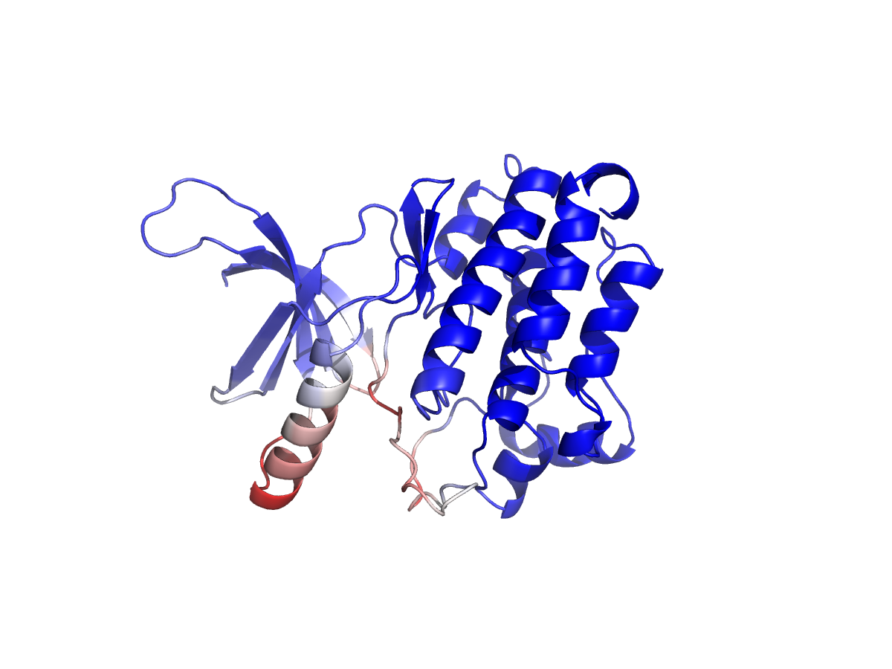
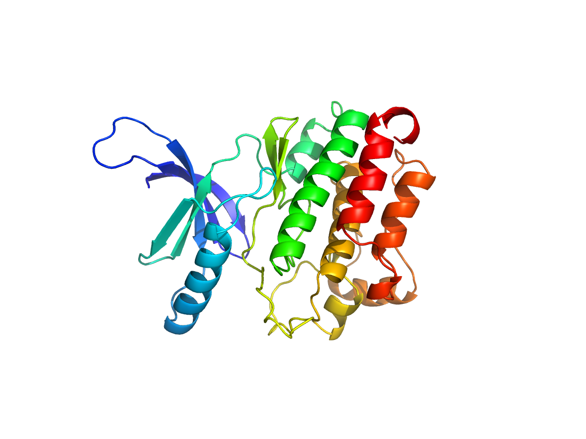

# EGFR Kinaz Domaini 3D Yapi Tahmini ve Dogrulamasi

## Amac
Bu proje, insan Epidermal Buyume Faktoru Reseptoru (EGFR) proteininin kinaz
domaininin amino asit dizisinden uc boyutlu yapisini tahmin etmeyi, gorsellestirmeyi
ve bagimsiz bir veritabani ile dogrulamayi amaclamaktadir. EGFR, kanser
biyolojisinde (akciger, meme, kolorektal kanser) en cok calisilan hedef
proteinlerden biridir ve bu proje ileride yapilacak bir docking (ilac hedefi)
projesi icin de temel olusturacaktir.

## Hedef Protein
- UniProt: P00533 (EGFR_HUMAN)
- Analiz edilen bolge: Kinaz domaini, amino asit 712-979 (268 aa)
- Tam protein uzunlugu: 1210 aa

## Yontem
1. EGFR tam protein dizisi UniProt'tan (P00533) FASTA formatinda indirildi
2. Kinaz domaini (712-979) Biopython ile diziden ayiklandi
3. ColabFold (AlphaFold2 tabanli, Google Colab uzerinde ucretsiz GPU ile) kullanilarak
   3D yapi tahmini yapildi (5 model, MMseqs2 tabanli MSA, 3 recycle)
4. En yuksek guvenilirlikteki model (rank_1, pLDDT=91.1, pTM=0.91) secildi
5. PyMOL ile yapi gorsellestirildi (pLDDT skoruna gore ve N->C renklendirmeli)
6. InterProScan ile dizi bazli bagimsiz domain dogrulamasi yapildi

## Kullanilan Araclar
Biopython, ColabFold (AlphaFold2), PyMOL, InterProScan (EBI web servisi)

## Sonuclar

### AlphaFold Guven Skorlari
5 modelin tumu yuksek guvenilirlik gosterdi:
- rank_1: pLDDT=91.1, pTM=0.910
- rank_2: pLDDT=90.9, pTM=0.912
- rank_3: pLDDT=89.5, pTM=0.896
- rank_4: pLDDT=90.9, pTM=0.906
- rank_5: pLDDT=89.8, pTM=0.905

pLDDT>90 degerleri "cok yuksek guven" kategorisindedir; domainin katalitik
cekirdegi neredeyse tamamen bu araliktadir, sadece dizinin en uc (esnek/loop)
bolgelerinde guven goreceli olarak dusmektedir.

### Yapisal Dogrulama
Modelde klasik protein kinaz katlanmasi (N-lob: beta-tabaka agirlikli,
C-lob: alfa-heliks agirlikli) net sekilde gozlemlenmistir - bu, bilinen
kinaz yapilariyla tutarlidir.

### Bagimsiz Dogrulama (InterProScan)
Modellenen dizi, InterProScan ile bagimsiz olarak tarandi ve asagidaki
sonuclar elde edildi:
- Pfam PF07714 (Protein tyrosine kinase): pozisyon 2-257, guven=0.9999995
- PRINTS PR00109 (Tyrosine kinase): 5 ayri motif eslesmesi
- SMART SM00219 (Tyrosine kinase catalytic domain): pozisyon 2-256
- PROSITE PS00107 / PS00109: kinazlara ozgu korunmus motifler
- PANTHER PTHR24416: tirozin kinaz aile siniflandirmasi

Bu bagimsiz dogrulama, AlphaFold'un urettigi yapinin gercekten bir tirozin
kinaz domaini oldugunu, veritabani duzeyinde teyit etmektedir.

## Sinirliliklar
- Bu bir yapi tahminidir, deneysel (X-ray/Cryo-EM) bir yapi degildir; ancak
  PDB'de EGFR kinaz domaininin bilinen deneysel yapilari mevcuttur ve ileride
  bu model onlarla karsilastirilarak dogruluk daha da netlestirilebilir
- Sadece kinaz domaini modellenmistir, EGFR'nin tam uzunluktaki (1210 aa)
  yapisi, ekstraselluler ve transmembran bolgeleri dahil edilmemistir
- Ligand/inhibitor etkilesimi bu asamada analiz edilmemistir (bu, planlanan
  docking projesinde ele alinacaktir)
- Bu bir portfoy/ogrenme projesidir, ilac tasarimi veya klinik karar alma
  icin dogrudan kullanilamaz

## Proje Yapisi
protein-yapi-egfr/
- data/      : EGFR tam dizisi ve kesilmis kinaz domain FASTA dosyalari
- scripts/   : PyMOL gorsellestirme scripti
- results/   : ColabFold ciktilari (PDB modelleri, skorlar)
- figures/   : PyMOL gorselleri, en iyi model PDB dosyasi
- README.md

## Sonraki Adim
Bu proje, yol haritasindaki bir sonraki asama olan "ilac hedefi / docking"
projesi icin temel olusturmaktadir - burada modellenen kinaz domaini,
AutoDock Vina ile potansiyel inhibitor moleculleriyle test edilecektir.

## Yazar
Atakan Aslan - Molekuler Biyoloji ve Genetik, Sivas Cumhuriyet Universitesi
